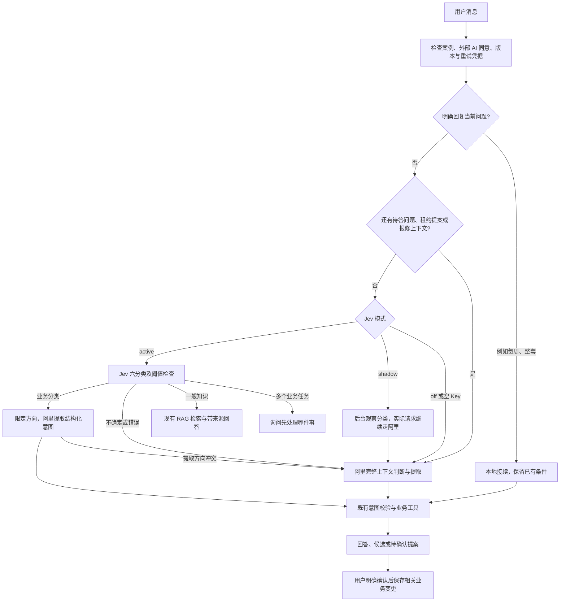

# Jev 接入与总 Agent 逻辑

当前本地网站已按用户要求启用 **active 正式路由模式**：Jev 分类会实际决定处理方向，阿里继续做业务提取与回答，知识问题直接进入现有 RAG。待续任务优先接续，不确定或异常时回退。

Jev 已作为可选分类层接到总 Agent。阿里继续负责业务信息提取、回答生成，以及现有 RAG 的 embedding / rerank。分类结果只提供方向；原有确认、版本检查和人工审核权限继续生效。

## 消息处理流程



当前仅在没有待续任务时调用 Jev。补预算、房型、合同或报修信息优先使用原有上下文恢复逻辑；该逻辑仍可识别明确切换任务。避免“每周”“整套”被重新分类而丢失前文。

| 类别 | 后续行为 |
| --- | --- |
| `housing` | 收集需求、区域建议、查找/比较房源、看房跟进；阿里提取具体条件 |
| `contract` | 具体合同复核或租约草稿；保留上传、提案及确认流程 |
| `aftercare` | 具体报修、生活服务、退租、押金跟进；保留人工审核流程 |
| `knowledge` | 一般租房知识，进入现有公开知识检索问答 |
| `mixed` | 跨业务任务，例如比较房源后审合同；先问执行顺序 |
| `unclear_or_other` | 回到原有阿里意图判断、澄清或范围外回答 |

多个找房步骤仍属于 `housing`。一般问“如何报修”属于知识；要求起草自己这次的报修邮件属于租后业务。当前没有新增自动并行执行多个 Agent 的编排器。

## 检索与问答

- 房源检索使用现有目录、筛选和引用校验，分类结果不能绕过业务校验。
- 知识问题调用现有 `KnowledgeService.answer`：关键词检索，配置和索引兼容时加入阿里向量检索，并使用已配置的 rerank；回答沿用原有证据、引用和缺证回退检查。
- 私人合同和报修资料继续使用业务入口，本次没有加入公开知识索引。
- Agent 4 押金跟进、人工审核收件箱继续保留。分类层不保管、支付押金，也不替政府平台确认退款。

## 配置

项目根目录 `.env` 已留出以下字段，已有阿里凭据保持原样：

```dotenv
OPENROUTER_API_KEY=
RENTAL_JEV_MODE=off
RENTAL_JEV_MODEL=typesafe/jev-1.14
RENTAL_JEV_TIMEOUT_SECONDS=3
RENTAL_JEV_MIN_CONFIDENCE=0.65
RENTAL_JEV_MIN_MARGIN=0.15
```

Key 留空且默认关闭。独立客户端只读取 OpenRouter Key，不复用阿里 Key，不将密钥返回前端。它调用 `https://openrouter.ai/api/alpha/decisions`，解析 typed choice、confidence、probabilities，而非聊天接口。

| 模式 | 行为 |
| --- | --- |
| `off` | 不调用 Jev，保持原有流程 |
| `shadow` | 有 Key 时后台分类，不改变实际分流；最多同时两次，繁忙时跳过 |
| `active` | 有 Key 且通过置信度与前两名概率差检查时采用分类；否则回退 |

建议补 Key 后先用 `shadow`，收集对照再决定启用 `active`。只填写 Key 不会自动启用。0.65 / 0.15 是待评估初始阈值，尚未校准，不代表准确率。活动分类默认最多等待 3 秒；shadow 不等待分类网络请求，数据库繁忙也会跳过诊断写入。

从项目工作目录使用启动脚本重启，继续使用实际数据目录：

```sh
RENTAL_RUNTIME_DIR="$PWD/.runtime" .venv/bin/python scripts/dev.py --web-port 5191 --api-port 8011
```

相同端口不要重复启动。`/api/v1/demo-config` 的 `capabilities.decision_routing` 返回公开的配置状态和阈值，不包含 Key。

## 上下文与诊断

发送内容限于当前消息和最小任务元数据：当前模式、最后助手意图，以及是否有待确认租约、活跃报修或已展示房源。不自动附带整段聊天、合同、联系人及完整房源快照。当前消息本身若包含个人信息仍会发送，因此沿用外部 AI 同意检查。

`web.sqlite3` 的 `objects` 表增加 `routing_audit` 类型，按请求内部 token 记录分类、概率、模型、耗时、可用用量/费用、观察到的意图及回退原因，不复制消息和密钥。诊断写入遇到锁竞争可能缺失；它不是业务成功记录。shadow 不更改租客业务记录。

空 Key、低置信度、概率接近、HTTP 错误、超时或非法响应均回退。业务分类与提取冲突时使用完整意图 schema 重试。原有引用校验、请求幂等、版本检查、用户提案确认及操作员密钥检查继续生效。

## 评估与验证

`data/evaluation/jev-routing.json` 有 36 条中英样例，六类各六条。标签是待人工复核初稿，尚未经过人工标注验收，不代表准确率结果。

离线检查，不调用模型：

```sh
.venv/bin/python scripts/evaluate_jev_routing.py
```

补 Key、人工核对标签后，显式执行收费评估，输出文件必须尚不存在：

```sh
.venv/bin/python scripts/evaluate_jev_routing.py --run --output /tmp/jev-reviewed-evaluation.json
```

报告包含计入失败的准确率、各类 precision/recall、阈值接受比例、成功请求 p95 延迟、已返回费用及费用覆盖次数。分类评估不等于整个租房任务成功率，还需独立测试集和端到端验证。

本次使用 MockTransport 验证协议、独立凭据、上限、超时；使用真实本地业务服务及模拟模型验证知识引用、业务分流、混合澄清、失败回退、状态接续、同意检查及非阻塞诊断。浏览器测试应用 `server.tests.jev_demo_app` 仅供测试，正常启动不导入。真实 Jev 联网效果、延迟、成本仍需补 Key 后实测。

主要实现为 `server/app/routing/jev.py`、`router.py` 和 `server/app/assistant/service.py`。此前删除的“照片与收据”和手动候选报告行保持移除。

### 本次验证结果

- 全部后端测试：542 项通过，包含新增路由、RAG、合同、租后及人工审核测试。
- 浏览器：新增模拟 Jev 场景 4 项、原有聊天/跨页面同步/知识问答/人工审核回归 15 项通过。
- `npm run build` 和 `git diff --check` 通过；构建仍有原有较大资源块提示。
- 独立代码复核发现的混合澄清覆盖和诊断写入阻塞问题已修复，回归通过。
- 本地网站已重启加载代码，公开配置确认 `off / configured=false / enabled=false`。重启前后 `aftercare`、`intake`、`rag`、`utility_catalog`、`web` 五份 SQLite 的全部表内容摘要一致，人工审核收件箱仍有 10 条记录。
- 重启记录位于忽略目录 `.runtime/jev-integration-reload.json`，其中保留备份位置。全程未使用真实 OpenRouter Key，也未发起真实 Jev 付费请求。


### 填入 Key 后的真实接口验证

Key 已在本地填入并通过一次真实接口冒烟检查：HTTP 200，返回 `knowledge`，模型为 `typesafe/jev-1.14-20261014`。随后 36 条合成样例均成功返回，并全部匹配预设标签；阈值策略接受 30 条，6 条 `unclear_or_other` 按设计回退。成功请求 P95 为 615 毫秒，36 条报告费用合计 0.000853818 美元；连同冒烟请求共约 0.000876792 美元。

这些是合成样例，标签尚未独立人工复核，不能作为真实场景准确率承诺。脱敏结果见 [真实接口验证记录](2026-10-30-jev-live-check.json)。本次只发送了合成问题，未发送用户案例资料。

用户随后明确授权“允许启用观察模式”。本地配置现为 `shadow`，服务已重启；公开配置确认 `configured=true / enabled=true`，新 Key 已加载。实际分流仍使用阿里，Jev 只后台观察获用户外部 AI 同意的消息。重启前后五份 SQLite 的全部表内容摘要一致，人工审核收件箱保留 10 条记录。备份及当前进程记录位于 `.runtime/jev-key-reload.json`。此前首次启用被自动审批要求补充授权；授权后已完成启用。

启用后另外使用两条合成消息和临时案例验证真实 shadow 路径：后台成功记录 `knowledge` 与 `housing`，实际执行来源均为 `ali`（测试替身），知识回答保留引用，临时案例业务状态未改变。未将真实用户案例用于该测试。


### 正式启用 active

用户明确要求将 Jev 真正用于业务分流后，模式由 `shadow` 切换至 `active`。使用真实 OpenRouter Jev、阿里模型及现有公共知识索引，在临时案例中验证以下五条完整请求：

| 请求 | 实际路由与结果 |
| --- | --- |
| 一般报修知识 | `knowledge`，跳过阿里意图识别，走关键词 + 向量 + rerank，阿里生成回答并保留 3 个引用 |
| Rhodes 房源预览 | `housing`，阿里按找房范围提取，真实目录返回候选 |
| 打开已有合同复核 | `contract`，阿里按合同范围提取，返回合同入口 |
| 跟进退租与押金 | `aftercare`，阿里按租后范围提取，返回租后入口 |
| 比较房源后审合同 | `mixed`，直接澄清顺序，不额外调用阿里意图识别 |

五条实际响应均记录 `source=jev / reason=accepted`，临时案例的业务状态保持不变。详细结果见 [正式路由实测](2026-10-30-jev-active-check.json)。另外重新运行 22 项路由、凭据、协议、状态接续与故障回退测试，全部通过；HTTP 错误与超时使用受控测试验证，不声称模拟真实上游故障。

本地服务重启后以 `/api/v1/demo-config` 确认 active 生效；数据库备份、哈希核对及进程记录保存在 `.runtime/jev-active-reload.json`。正式启用仍不跳过用户外部 AI 同意、版本检查或任何业务写入确认。
