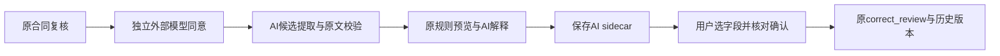

# 给 Agent 3 同学的本地 AI 接入核对单

本轮没有上传。请先核对方案与本地改动，再决定如何纳入你的模块分支。

## 使用的 GitHub 代码

GitHub main：`4701fa1`。Agent 3 基线目录树：`60d469b2ab24986124d4f4d5fc275a3ff09b944f`，与本轮前端基线 `2e375bb` 内的 Agent 3 一致。没有引入你尚未合并的 M3/M4 其他功能分支。

## Agent 3 改了什么

仅新增两份模块文件：

- `agent3/contract_agent/ai_analysis.py`：`analyze_contract(document, review, gateway)`，接收已加载的合同、原 ContractReview 和注入的 JSON gateway。返回候选、原规则预览、解释和解释状态。
- `agent3/tests/test_ai_analysis.py`：引用、类型、未知/重复字段、伪造金额/日期/来源、原规则门禁、原对象不可变、解释引用/失败及跳过场景。

原 extract.py、review.py、intake.py、model_gateway.py、ContractReview Schema、CLI 和示例报告未修改。默认 receive/review 仍运行原规则模式。

## 需要你重点确认的接口

提取 gateway 上下文 `task=contract_extract`，含 `document.text/source_name` 及字段清单。模型返回：

```json
{"fields":[{"field":"rent_amount","value":500,"line":5,"quote":"The weekly rent payable is AUD 500 per person."}]}
```

行号是带 `[page N]` 标记的 document.text.splitlines() 的1-based索引，示例行号须按实际文本调整。非空值必须有完整原文行逐字引文；来源名、页码由本地文档推导。支持字段 address/rent_amount/start_date/end_date/rent_period/rent_scope/currency，缺失/不可信字段保留待确认。

解释 gateway 上下文 `task=contract_explain`，只含已有确定性发现及其证据。返回 `{"explanations":[{"finding_id":"F01","text":"..."}]}`，必须完整匹配已有发现ID，不允许创建发现或改变严重程度。没有发现时不调用解释模型；解释失败保留候选和规则预览。

## 前后端如何衔接



- `server/app/ai/provider.py`：统一后端配置及模型传输、真实调用记录，无密钥进入前端。
- `server/app/ai/service.py`：只读取服务器已保存的版本/选房/同意，保存独立 AI 结果与请求收据，网络期间不占数据库写事务。
- `server/app/ai/contracts.py`：安全加载保存的合同并调用你的新增模块；用户确认后再调用原 correct_review。
- 原 `ContractsAdapter` 仅提取可复用 save_review 方法，仍验证原 Schema，保存不可变历史。
- `frontend/src/features/ai/ContractAi.tsx`：候选、原文、预览、解释、勾选与确认、过期结果和调用状态。

API形状见 [本轮方案](2026-10-20-ai-integration-plan.md)。本轮返回的 AI sidecar 不向拒绝额外字段的 ContractReview 填入新属性。

## 核对清单

- [ ] 认可新增 pure function 的位置、输入输出格式及字段范围。
- [ ] 核对与现有提取/规则/人工审核的职责分工；模型不放行合同，不自动接 M4。
- [ ] 原命令行测试仍通过；本轮新增候选引用测试的判断符合模块约定。
- [ ] 明确人工确认应用后的字段证据仍沿用原 tenant correction 语义，原AI引文保留在sidecar及应用收据中供追溯。
- [ ] 在自己的模型配置上用合成合同实测；正常、租金冲突、无效引用/超时都能正确展示。
- [ ] 确认学校/其他服务协议与配置；API Key 仅后端本机保存。

本地核对补丁会保存在课程资料根目录 `docs/frontend/agent3-ai-local.patch`。它只包含上述两个新增 Agent 3 文件，供完整小组仓库根目录运行 `git apply --check <补丁路径>` 检查；审核后再决定是否应用。完整栈改动仍仅保留在本地分支，尚不能通过远端拉取。
