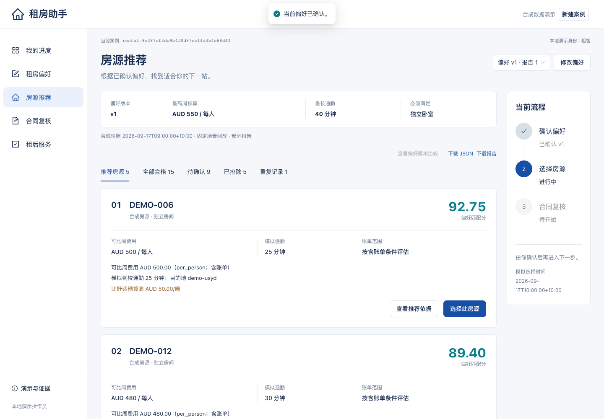

# 统一前端验证记录

验证日期：2026-10-17。基线：`b06614de1c7825d7fbc4bcc773a75efa4eb1da97`；分支：`codex/frontend-demo`。这是开发验证记录，尚未进行教师验收或目标用户测试。

## 实现与验证范围

React / TypeScript / Ant Design 页面通过 FastAPI 适配层调用原 Agent 2、3、4 Python 入口。原 `agent2/`、`agent3/`、`agent4/`、`integration/` 内容保持不变。Agent 1 使用有明确标识的模拟偏好表单，外部模型关闭；合同复核到租后案件仍须租客核对并确认租约资料。

所有演示使用合成输入。浏览器只持有案例引用，服务端 SQLite 保存确认版本、模块结果、独立同意、历史和冻结请求收据；上传与密钥保存在忽略目录 `.runtime/`。测试中的 `qa-local-key` 只是临时测试服务凭据，正常启动脚本改用随机本机密钥，前端构建不包含该密钥。

## 可重复执行的命令

先按 [运行说明](implementation.md) 安装并启动前后端。测试从本仓库根目录执行：

```sh
.venv/bin/python -m unittest discover -s server/tests -v
(cd agent2 && ../.venv/bin/python -m unittest discover -s tests -v)
(cd agent3 && ../.venv/bin/python -m unittest discover -s tests -v)
(cd agent4 && ../.venv/bin/python -m unittest discover -s tests -v)
.venv/bin/python -m unittest discover -s integration/tests -v
npm --prefix frontend run build
(cd frontend && npx playwright install chromium)
```

浏览器回归包含操作员场景，需单独启动临时测试 API，使用 `RENTAL_OPERATOR_KEY=qa-local-key`，再运行 `npm --prefix frontend run test:e2e`。测试只针对合成案例，正常演示服务使用随机密钥。浏览器测试要求端口 5173 和 8000 可用；不会自行启动或停止服务器。

本机 Playwright 使用已有 Chromium 1228，测试时通过 `PLAYWRIGHT_CHROMIUM_EXECUTABLE` 指向其可执行文件；其他机器安装 Playwright 匹配浏览器后无需设置该变量。生产包检查先运行 `npm --prefix frontend run preview`，再以 `WEB_TEST_BASE_URL=http://127.0.0.1:4173` 执行核心旅程测试。

## 已执行结果

| 检查 | 实际结果 |
|---|---|
| 服务端边界与持久化 | 25 / 25，通过，2.911 秒（含最后两项旧合同上下文回归） |
| 原 Agent 2 | 71 / 71，通过，2.495 秒 |
| 原 Agent 3 | 25 / 25，通过，2.016 秒 |
| 原 Agent 4 | 57 / 57，通过，2.422 秒 |
| 原交接集成 | 6 / 6，通过，2.547 秒 |
| Python 合计 | **184 项通过** |
| TypeScript + Vite 生产构建 | 通过；3117 模块；路由按需加载，共享 vendor 约 1.14 MB（gzip 362 KB），保留大块警告，待后续性能优化 |

完整命令输出保存于 [logs/](logs/)，避免把运行数据库、上传文件、绝对路径或操作员密钥作为交付物。浏览器与启动器最终结果见本文件末尾。

## 交接清单对应证据

| 项目 | 已检查的可观察行为与证据 |
|---|---|
| F01–F02 确认和版本 | 未确认无法评估；修改预算需保存并重新确认；v1/v2 报告保留。API 检查旧选择与当前确认绑定；浏览器检查失败的报告切换不会把旧内容当作新报告操作。 |
| F03–F04 排名与空结果 | 真实 30 条输入得到 15 合格、9 待确认、5 排除、1 重复；Top 1 为 DEMO-006，92.75 分；待确认不评分、不提供选房按钮；AUD 1 得到有效零匹配。 |
| F05–F06 选房与证据 | 明确确认后生成真实选房包，检查导出 listing_id；过期绑定被拒绝；依据抽屉展示原 source_ref 和观察时间，不刷新证据日期。 |
| F07 同意前边界 | 浏览器在服务端记录独立同意前不挂载文件输入；直接 ASGI 测试证明未同意、错误 content-type 情况均在读取 body 前拒绝，无落盘。 |
| F08–F10 正常、重试、冲突 | 对应正常合成合同得到 Reviewed；重复上传保持原 ID/报告，改内容冲突；租金 650 场景等待人工决定，租客无放行权，放行后问题包仍是 prepared_not_sent。 |
| F11 文件与暂停 | API 验证允许类型、路径、超限无残留以及无 Content-Length 的流式超限；原模块测试保留提取/规则边界。浏览器未逐一覆盖所有 OCR/损坏文档/规则过期组合，不宣称完整 F11 人工验收。 |
| F12 修正和历史 | 修正后版本递增、问题失效；旧快照内容不变；撤销同意后历史仍可读、后续写入被拒绝，刷新保留撤销状态。 |
| F13 租后确认 | 合同完成不自动创建 M4；未核对确认租约表单，创建按钮禁用；独立入口可在明确确认后建案。 |
| F14 计划、任务、改期 | 改期提案确认前保留原计划；期间编辑任务省略不可改的 due_date；确认后保留完成状态和证据。原 M4 完整命令流程与浏览器均覆盖。 |
| F15 押金门禁 | 争议进入 UnderReview；普通租客不能放行；独立操作员授权后按原条件继续，未发送草稿可查看。 |
| F16 提醒和关闭 | 提醒默认关、显式开；活跃页面查询，失败命令期间暂停后台查询；实际合成时钟下检查提醒和明确关闭。原模块回归检查提醒去重与关闭抑制；无后台投递服务。 |
| F17 故障恢复 | 浏览器模拟服务器已执行但响应丢失，原 input/request_id/expected_version 重试不变；模态框保留输入。取消失败任务 A 后编辑 B 不暴露 A 重试；读取既有案件失败只显示恢复，不误建新案；失败跨案例导航不显示旧案例可写表单。 |
| F18 布局与键盘 | 360/768/1440 无文档横向溢出；键盘 Enter 打开依据、Escape 关闭；文本状态、表单标签、确认摘要键盘滚动。未进行完整屏幕阅读器或 WCAG 认证审计。 |
| F19 数据与密钥 | 仅合成演示、无外发；检查受控上传路径和构建产物边界；操作员密钥仅服务端配置/本机文件，输入仅页面内存。 |
| F20 原功能 | 原模块 71 + 25 + 57、交接 6 项全部通过，未修改原业务目录。 |

## 实际界面与设计对照

以批准的 [Markdown 方案](2026-10-17-frontend-plan.md) 为准，辅以 [推荐页概念图](design/recommendations-concept.png) 和 [设计规范](design/design-system.md)。比较实际桌面、移动截图后检查了以下五点：

1. 保留深蓝侧栏、68px 顶栏和浅灰内容背景，主操作为蓝色、辅助证据用青色。
2. 主标题、说明、当前确认版本、分类、房源行依次呈现；真实结果的数字和排名清晰可辨。
3. 房源按紧凑列表展示标题、费用、分数和依据；待确认、排除与重复记录有独立文本状态。
4. 桌面侧栏和多列信息在移动端收拢，360px 下按钮换行、长引用换行、依据以整屏抽屉阅读。
5. 确认、独立同意、证据和失败恢复保持可访问；增加真实版本历史、导出和演示时钟说明，均为已批准需求下的数据驱动补充。

概念图仅决定布局与视觉方向，其中示意数字和地址以真实模块返回替换。实际页不使用虚构房源照片或营销插图。修复过确认表单隐藏字段丢失、异步读取沿用旧案例、短视口摘要裁切，以及失败编辑重试跨任务残留等问题；没有以截图代替交互验证。生产包运行检查还发现按大小强拆依赖导致循环初始化错误；已改为稳定共享依赖块并实际重跑，未仅凭构建退出码判断可用。



[移动推荐页](screenshots/recommendations-360.png) · [平板推荐页](screenshots/recommendations-768.png) · [合同复核](screenshots/contract-desktop.png) · [租后服务](screenshots/aftercare-desktop.png)

## 范围限制与后续验收

- 本地演示没有生产登录、账号隔离、TLS、后台任务或真实通知。独立同意可撤销，撤销不等于删除原文件；文件在忽略目录保留，没有保留期/24 小时删除 API。
- Agent 1 不包含真实对话/模型；外部模型、真实房源、付款、签约与消息发送均未接入。M3 到 M4 的资料需用户核对，不声称自动完成交接。
- 复核完成不代表法律认证或签约批准。模型错误与自动重试的 Stage 1 完整生产目标尚未验收；本次为保留原请求的显式人工重试。
- Stage 1 报告第 14 页 NFR05/NFR06 要求的 30 次工作负载测量、5 并发、p95 时延，以及 5 名目标用户的 10 分钟任务测试均未执行；184 项 Python / 浏览器回归不替代这些验收。
- PDF 文本/OCR 取决于本机依赖，未验证所有扫描件；跨数据库恢复依赖原模块冻结收据，没有跨库分布式事务。
- 本地提醒显式开启，页面活跃时每 30 秒查询，页面关闭不保证投递。评估、选房、合同规则和 M4 回放时钟分别保留并标注。

关联已有工作项：[SCRUM-2](https://breezebee64.atlassian.net/browse/SCRUM-2)、[SCRUM-25](https://breezebee64.atlassian.net/browse/SCRUM-25)、[SCRUM-8](https://breezebee64.atlassian.net/browse/SCRUM-8)、[SCRUM-20](https://breezebee64.atlassian.net/browse/SCRUM-20)。这里只记录对应关系，没有修改 Jira 状态或声明成员/教师签收。


## 最终复查与运行检查

- [前端聚焦复查](reviews/frontend-final.md) 与 [整体接口/边界复查](reviews/whole-branch.md) 最终批准。复查发现的旧合同上下文写入漏洞已由 `860bfad` 修复；修改未确认偏好、同确认版本改选房源，均使旧合同后续写入拒绝，历史仍可读。
- 生产包在 4173 上执行完整“确认偏好 → 推荐 → 明确选房 → 独立同意 → 上传 → 复核 → 刷新恢复”：**1 项通过，12.9 秒**，主流程无 pageerror、console error 或 Vite 错误覆盖层。[实际日志](logs/production-browser.log)。
- 启动器隔离生命周期检查：API 子进程失败退出时，启动器返回失败码并停止 npm 及其测试子命令，无遗留；当前机器上的观察结果不构成跨平台保证。

- 最终开发服务浏览器回归：**12 / 12 通过，58.3 秒**。[实际日志](logs/browser-tests.log)。其中正常旅程同时断言无 pageerror、console error 和错误覆盖层；故障注入测试按预期验证错误恢复，不将这些故意触发的 HTTP 错误归为正常路径错误。

- 真实组合启动器已启动：5173 首页、5173 代理 `/api/v1/health`、8000 `/docs` 均返回 200；自动生成的本机操作员密钥非空且权限为 0600。测试 API 已停止，预览服务改用随机密钥。


## 提交与评审入口

草稿 [PR #4](https://github.com/seven77-ops/elec5620-group3-rental-agent/pull/4)，核心前端提交 `35211fd`，最终后端门禁修复 `860bfad`；分支 `codex/frontend-demo`。创建前重新 fetch，main 仍为本文基线。PR 未合并，Jira 未更改。
